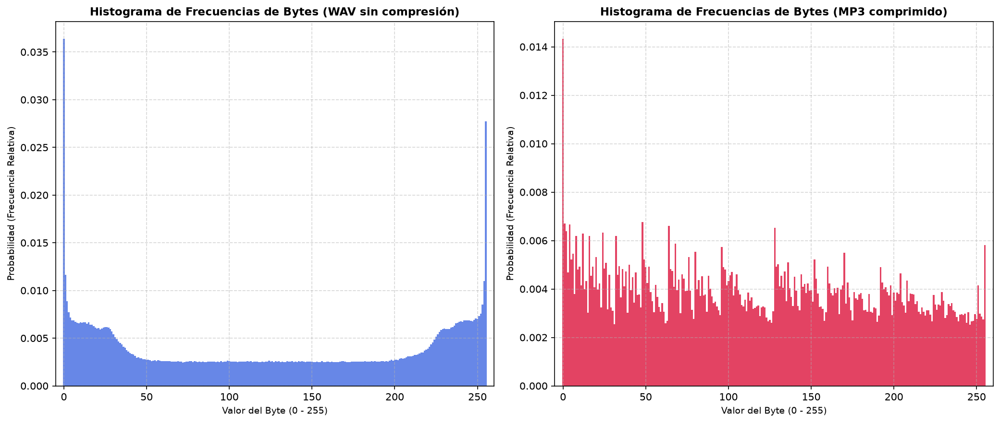

## Resultados Obtenidos

| Métrica | Archivo WAV (Sin Compresión) | Archivo MP3 (Comprimido) | Comparativa y Significado |
| :--- | :---: | :---: | :--- |
| **Tamaño del Archivo** | 2,283,664 bytes | 280,700 bytes | El archivo MP3 es **8.13 veces más pequeño** (reducción del 87.7%). |
| **Entropía de Shannon ($H$)** | 7.745859 bits/byte | 7.950586 bits/byte | Ambos archivos registran una entropía altísima por byte. |
| **Entropía Máxima ($H_{max}$)** | 8.000000 bits/byte | 8.000000 bits/byte | Límite teórico para un alfabeto de 256 símbolos (8 bits). |
| **Redundancia ($R$)** | 3.18% | 0.62% | La redundancia matemática directa es baja en ambos a nivel individual. |

---

##  Visualización: Histograma de Frecuencias

El gráfico muestra cómo se distribuyen las probabilidades de aparición de cada uno de los 256 valores posibles del byte (de 0 a 255):

##  El "Engaño" de la Entropía

Si el archivo WAV pesa **8 veces más** que el MP3 y contiene la misma canción, tiene que tener muchísima información repetida (redundancia). Entonces, **¿por qué su entropía dio 7.74 bits/byte, casi tan alta como la del MP3 (7.95 bits/byte)?**

Este fenómeno se conoce en Teoría de la Información como el **engaño de la entropía de primer orden** y se debe a tres razones fundamentales:

### 1. El "Truco" del Byte de Detalle Fino (LSB)
La mayoría de los archivos WAV de audio digitalizan el sonido usando **16 bits por muestra**. Esto significa que cada muestra de sonido se compone de **dos bytes**:
* **El byte "grande" (MSB - Most Significant Byte):** Controla los cambios principales del volumen y la onda de audio. Este byte es muy ordenado y predecible.
* **El byte "chico" (LSB - Least Significant Byte):** Controla los detalles microscópicos del sonido, incluyendo imperfecciones de la grabación y ruido de fondo.

A nivel de detalle fino (LSB), los valores cambian de forma caótica y veloz. Para el analizador de bytes, este byte microscópico parece **puro ruido aleatorio** (con entropía de casi 8 bits). Al analizar el archivo "byte por byte" de forma plana, el ruido del LSB actúa como una cortina de humo que infla artificialmente la entropía total del WAV, ocultando el orden del archivo.

### 2. La Entropía de Shannon no tiene "Memoria"
La fórmula clásica de entropía que calcula el programa asume que la fuente **no tiene memoria** (es decir, que la aparición de un byte no depende del byte anterior). 
* En la música real, si una muestra de audio tiene un volumen alto, la siguiente muestra milisegundos después también lo tendrá. Existe una **altísima correlación temporal** (memoria).
* El archivo WAV guarda el audio en el dominio del tiempo muestra tras muestra, por lo que su verdadera redundancia está en la **secuencia** de los bytes, no en la frecuencia con la que aparecen de forma aislada.
* El compresor MP3 se aprovecha de esta memoria para agrupar y descartar lo repetido. Por eso el MP3 logra ser tan pequeño: elimina la redundancia de las secuencias. Lo que queda dentro del MP3 son datos ultra condensados y descorrelacionados, por lo que su entropía es genuinamente alta.

### 3. El Ruido Físico no es Información
Cualquier grabación analógica arrastra ruido térmico de los micrófonos o ruido de cuantización de la tarjeta de sonido. En Teoría de la Información, **el ruido físico equivale a entropía máxima**. El analizador de software no puede distinguir entre música hermosa y ruido molesto; para el algoritmo, ambos son "incertidumbre", lo que eleva el valor del WAV de manera ficticia.
