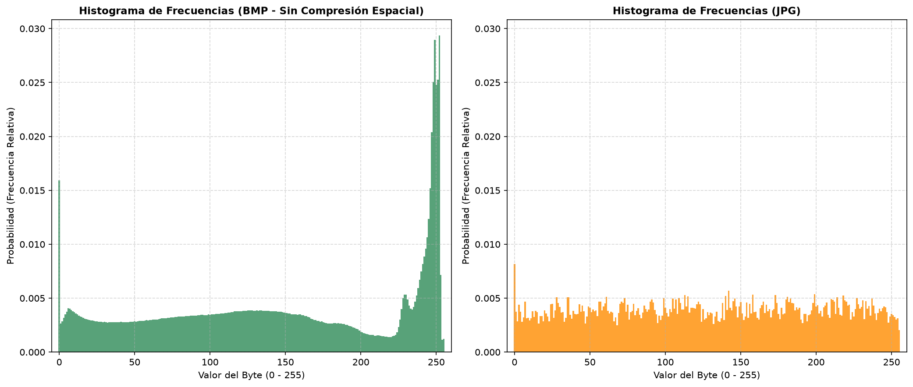

### Resultados Obtenidos
```
  === [a] FASE DE CARGA Y VALIDACIÓN ===
  ✔ Ambos archivos existen en el sistema.
  ✔ Firma binaria BMP validada con éxito ('BM' detectado).
  ✔ Firma binaria JPG validada con éxito (SOI 0xFFD8FF detectado).

  === [b] ANÁLISIS DE LA CABECERA DEL ARCHIVO BMP (54 BYTES) ===
    • Signature      : BM
    • FileSize       : 16,002,138 bytes
    • DataOffset     : 138 bytes
    • HeaderSize     : 124 bytes
    • Width          : 2,000 px
    • Height         : 2,667 px
    • Planes         : 1
    • BitCount       : 24
    • Compression    : 0 [BI_RGB (Sin compresión)]
    • ImageSize      : 16,002,000 bytes
    • XPixelsPerM    : 11,811 px/m
    • YPixelsPerM    : 11,811 px/m
    • ColorsUsed     : 0
    • ColorsImportant: 0

  === [c] CÁLCULO DE DISTRIBUCIÓN DE PROBABILIDADES ===
    • Archivo BMP procesado: 16,002,138 bytes analizados.
    • Archivo JPG procesado: 1,275,869 bytes analizados.
    • Relación de compresión: 12.54:1 (Reducción del 92.03% de espacio)
  ✔ Distribuciones de probabilidad calculadas.

  === [d] GENERACIÓN DE HISTOGRAMAS COMPARATIVOS ===
  ✔ Gráficos de histogramas guardados exitosamente en: histogramas_imagen.png

  === [e] CÁLCULO DE ENTROPÍA DE SHANNON ===
    • Entropía empírica de Shannon:
      - Archivo BMP (sin compresión): 7.644859 bits/símbolo (byte)
      - Archivo JPG (comprimido):     7.975616 bits/símbolo (byte)
    • Redundancia de la fuente (R = 1 - H/H_max):
      - Archivo BMP: 4.44%
      - Archivo JPG: 0.30%
```


A primera vista, podría parecer contradictorio que una fotografía en formato BMP crudo registre una entropía tan cercana al límite máximo de 8 bits por byte . La razón de este fenómeno es análoga a la que vimos en el audio WAV:

- La Redundancia de una Imagen es Espacial 2D (Memoria): Una fotografía posee una enorme correlación entre píxeles vecinos (por ejemplo, el cielo, una pared o la piel mantienen tonos similares en bloques adyacentes). Sin embargo, la fórmula de entropía de primer orden analiza los bytes de forma aislada e independiente (asume una fuente de memoria nula). Ignora por completo que el píxel $(x, y)$ es casi idéntico al píxel $(x+1, y)$ o al $(x, y+1)$.

- Entrelazado de Canales RGB: Los píxeles se almacenan secuencialmente en formato binario como R G B R G B R G B.... Al leer byte a byte, mezclamos en una misma distribución estadística el canal Rojo, el Verde y el Azul de toda la imagen.

- Ruido de Sensor de la Cámara: En fotos reales capturadas por sensores de cámara, los bits menos significativos de cada canal de color contienen ruido térmico y variaciones microscópicas de luz. Este ruido aleatorio dispersa la frecuencia de los 256 valores posibles, elevando la entropía medida a nivel de bytes individuales.

---

### Histogramas


- BMP (Sin compresión): Presenta un histograma con picos y valles 
- JPG (Comprimido): Presenta un histograma distribuido de manera mas  uniforme con una entropía empírica muy alta, rozando el límite teórico

#### ¿Por qué el histograma del archivo BMP presenta picos? 
El histograma del archivo BMP (sin comprimir) presenta picos debido a que las probabilidades de ocurrencia de los bytes en el archivo estan desbalanceadas. Se puede ver el pico alrededor del byte 240 aproximadamente que indica que estos bytes ocurren de manera muy frecuente en el archivo. También se puede ver que valores de bytes cercanos tienen frecuencias relativas similares, lo que genera esas curvas mas suaves que en el histograma del archivo JPG. 

#### ¿Por qué el archivo JPG es uniforme y con entropía cercana al máximo?
- Eliminación de redundancia: El algoritmo JPEG elimina la redundancia espacial transformando la imagen al dominio frecuencial (DCT), cuantizando detalles imperceptibles y empaquetando los datos mediante codificación estadística de longitud variable (Huffman)2more_horiz.
- Códigos compactos: Según el Teorema de Codificación de Fuente de Shannon, un compresor óptimo asigna secuencias de bits inversamente proporcionales a la frecuencia de los datos.
- Equiprobabilidad de bytes: Al haber removido todas las dependencias y patrones repetitivos del archivo, los bytes resultantes dentro del contenedor JPG se vuelven estadísticamente independientes y equiprobables.
- Límite de Shannon: La Teoría de la Información establece que la entropía alcanza su máximo valor absoluto cuando todos los símbolos de la fuente son equiprobables. Por ello, el flujo binario comprimido de un JPG se comporta estadísticamente como si fuera ruido blanco aleatorio de máxima incertidumbre.

--- 