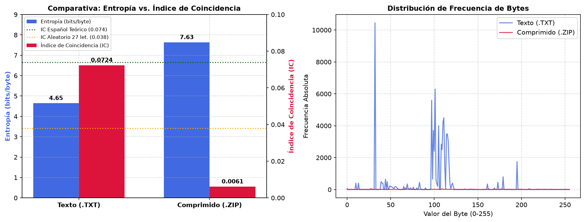

### Comparacion de los valores de Entropía (H) e Índice de Coincidencia (IC).

Se puede ver como la Entropia es alta cuando IC es bajo y viceversa. Es decir existe una relacion inverssa entre ellos. Esto se debe a que el IC mide la probabilidad de que dos símbolos elegidos al azar sean iguales, por lo que cae a su valor mínimo cuando la compresión hace que todos los bytes se vuelvan equiprobables.